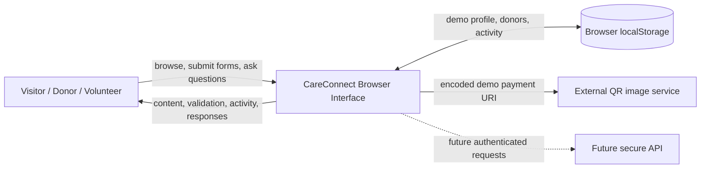
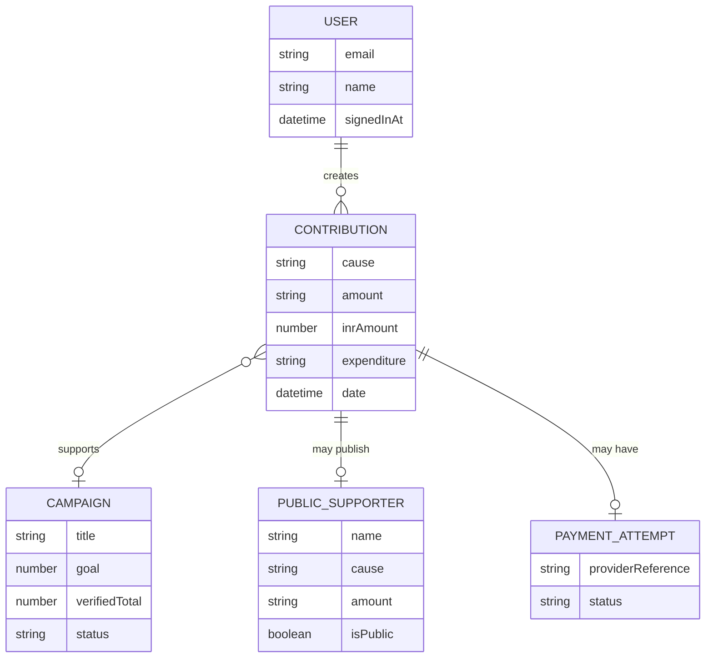
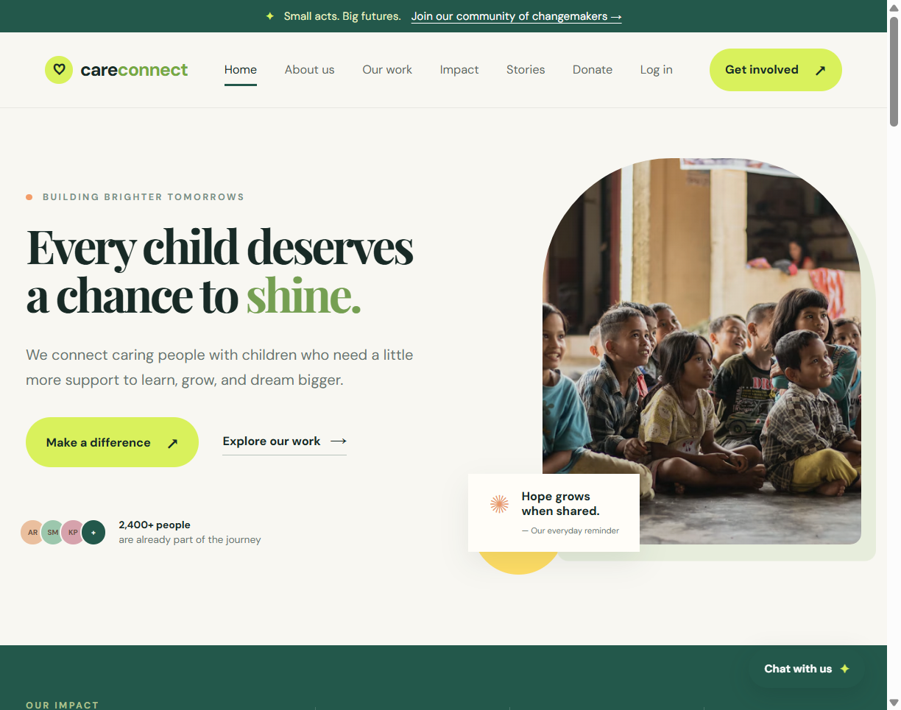
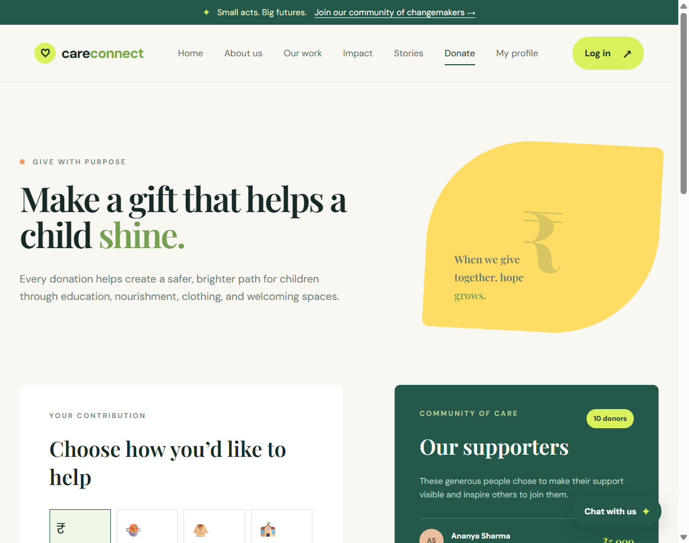

# CareConnect NGO

## Project Documentation

CareConnect NGO is a browser-based prototype for an education and community-support NGO. The website helps visitors understand the NGO's mission, explore programs and current needs, contribute through a demo donation flow, volunteer, view public supporter information, and review private browser-local activity.

> **Implementation note:** The current repository is a static HTML, CSS, and JavaScript prototype. It does not contain a production backend, database, secure authentication service, or real payment gateway. Production recommendations in this README are clearly marked as future scope.

## Table of Contents

| Sr. No. | Title | Page No. |
|---:|---|---:|
| 1 | Abstract | 1 |
| 2 | Introduction | 2 |
| 2.1 | Motivation | 2 |
| 2.2 | Problem statement | 3 |
| 2.3 | Purpose/objective and goals | 3 |
| 2.4 | Literature survey | 4 |
| 2.5 | Project scope | 4 |
| 3 | System analysis | 5 |
| 3.1 | Existing systems | 5 |
| 3.2 | Scope and limitations of existing systems | 6 |
| 3.3 | Project perspective, features | 6 |
| 3.4 | Stakeholders | 7 |
| 3.5 | Requirement analysis | 7 |
| 4 | System Design | 9 |
| 4.1 | Design constraints | 9 |
| 4.2 | System Model: ERD & DFD (Context Level) | 10 |
| 4.3 | Data Model | 12 |
| 4.4 | User Interface | 13 |
| 5 | Implementation details | 15 |
| 5.1 | Software / hardware specifications | 16 |
| 6 | System Outputs and Validation | 17 |
| 6.1 | Output Screen | 17 |
| 6.2 | Input Validation | 18 |
| 6.3 | Report Format | 19 |
| 7 | Conclusion and Recommendations, Limitations & Future Scope | 20 |
| 8 | Bibliography and References | 22 |

---

## 1. Abstract

CareConnect NGO is a public-facing web prototype created for an organization focused on children's education, nutrition, wellbeing, mentorship, and community support. The website presents the NGO's mission through a responsive landing page and provides visitors with several ways to participate.

The implemented prototype contains:

- A public home page with mission messaging, impact figures, programs, current needs, campaign progress, stories, and volunteer registration.
- A donation page supporting money, food, clothes, and learning-space contribution categories.
- Currency selection for INR, USD, EUR, GBP, AED, AUD, CAD, and SGD.
- Preset and custom donation amounts.
- Anonymous-giving support so a donor can keep their name off the public supporter list.
- A browser-local private profile containing donation activity.
- A demo login flow that stores a name, email, and sign-in timestamp in `localStorage`.
- A deterministic helper chatbot for donations, privacy, volunteering, currency, and profile questions.
- Responsive navigation, accessible labels, modal dialogs, validation messages, and GitHub Pages deployment.

The project is intentionally implemented as a static prototype. Donation activity is stored only in the visitor's browser, and the payment screen displays demonstration details rather than processing a real payment. The project can be extended into a complete NGO management platform by adding a secure API, relational database, role-based staff portal, verified payment integration, inventory management, education-program management, volunteer administration, audit logging, and aggregate reporting.

### Abstract expansion: approach and expected contribution

The project follows a progressive approach. First, it establishes the public information architecture and visual language. Second, it adds the most important supporter interactions: selecting a contribution, deciding whether recognition is public, receiving next-step payment information, and reviewing activity. Third, it documents the technical and ethical boundary between a browser demonstration and a production NGO system.

The expected contribution of the project is a reusable front-end foundation. A student or NGO team can use the current interface to discuss requirements with stakeholders before investing in a complete backend. The screens make abstract requirements visible: a donor can see what information is requested, a volunteer can see how participation begins, and a reviewer can see where privacy and payment controls must be strengthened.

The project also demonstrates responsible technical communication. It does not claim that a local storage record is a successful payment, that a demo login is secure authentication, or that sample impact numbers are audited statistics. This distinction is essential for a system connected to charitable giving and children’s welfare.

### Abstract keywords

**CareConnect NGO, charitable giving, education support, responsive web design, browser-local storage, privacy by design, donation workflow, volunteer engagement, impact communication, input validation, GitHub Pages.**

---

## 2. Introduction

Small NGOs often need to communicate their mission and activities with limited staff, limited technology, and limited administrative resources. A clear public website can reduce communication barriers by explaining the organization, showing current needs, and offering simple participation paths.

CareConnect is designed as a trust-oriented public portal. It does not present donation as an isolated transaction. Instead, it connects contribution choices with practical outcomes such as school supplies, meals, learning support, and safe learning spaces.

The project uses standard browser technologies:

- HTML5 for page structure and forms.
- CSS3 for layout, design tokens, responsive behavior, and visual components.
- JavaScript for interaction, validation, modal dialogs, filtering, local storage, and chatbot responses.
- GitHub Actions and GitHub Pages for static deployment.

The source implementation is divided into three main user-facing pages:

| Page | Purpose |
|---|---|
| `index.html` | Public mission, programs, impact, needs, volunteer form, and chatbot |
| `donation.html` | Donation form, supporter list, payment demo, and private activity |
| `login.html` | Demo login for accessing the browser-local supporter profile |

### Development methodology

The prototype was developed using an iterative, feature-oriented method:

1. Define the public mission and information hierarchy.
2. Build the landing page and reusable visual components.
3. Add contribution categories and current-needs communication.
4. Add the separate donation page and supporter list.
5. Add local profile activity and the demo login flow.
6. Add validation, modals, responsive navigation, and chatbot support.
7. Review privacy wording and separate implemented features from future scope.
8. Configure static deployment through GitHub Pages.

This method keeps the most visible user journey working at every stage and makes it easier to replace individual browser-only behaviors with API calls in a later version.

### Assumptions

- All sample donors, impact figures, stories, and payment values are synthetic.
- The prototype is used for academic demonstration and interface review.
- Visitors understand that the payment screen is a demonstration.
- No real child, donor, volunteer, or bank information is entered during testing.
- A production organization will define its own policies for consent, retention, reporting, and safeguarding.

---

### 2.1 Motivation

The project is motivated by the need for an approachable digital presence for NGOs. Potential supporters may want to help but may not know:

- What the NGO does.
- What resources are currently needed.
- Whether a small contribution is useful.
- How to volunteer time or skills.
- Whether their name will be displayed publicly.
- How to review their own contribution activity.

CareConnect responds to these questions through visual storytelling and direct calls to action. The impact section gives visitors a quick summary, program cards explain the work, need rows connect amounts with outcomes, and the donation page provides a straightforward contribution journey.

The project is also motivated by the need to demonstrate privacy awareness. The prototype gives users an anonymous option, explains browser-local storage, warns against entering real passwords, and states that payment details are not stored.

---

### 2.2 Problem Statement

The problem addressed by CareConnect is:

> How can an NGO provide a clear, engaging, and privacy-conscious public web experience that communicates its mission, encourages donations and volunteering, and allows supporters to review demo activity without requiring a complete backend system?

Many small organizations rely on disconnected social-media pages, messages, spreadsheets, or manual records. These methods can make it difficult for visitors to understand impact and difficult for the organization to communicate consistent information.

The current prototype addresses the public communication problem, but not the complete operational problem. It does not yet provide:

- Secure centralized donor records.
- Real payment settlement.
- Staff accounts or role-based authorization.
- Database-backed campaign totals.
- Inventory transactions.
- Education attendance records.
- Financial reconciliation.
- Audit logs.

These are identified as future requirements rather than falsely represented as current features.

### Problem impact

If a public NGO website does not clearly communicate its work, visitors may abandon the page before taking action. If contribution instructions are unclear, donors may not understand what their support enables. If privacy controls are hidden, users may avoid participation. If impact figures are not explained, the public may find them difficult to trust.

CareConnect addresses these communication impacts with a single journey:

```text
Understand the mission
        ↓
Explore programs and needs
        ↓
Choose a way to help
        ↓
Review privacy and contribution details
        ↓
Receive feedback and next steps
```

The prototype does not solve the organization’s internal data problem yet. Instead, it exposes that problem clearly so the next system design can address it with a database, service layer, permissions, and auditability.

---

### 2.3 Purpose, Objectives and Goals

#### Purpose

The purpose of CareConnect is to demonstrate a warm, transparent, and usable NGO web experience that turns visitor interest into meaningful actions.

#### Objectives

1. Explain the NGO's mission and social purpose.
2. Present education, nutrition, wellbeing, and mentorship programs.
3. Show aggregate impact figures and campaign progress.
4. Provide multiple donation categories and currencies.
5. Allow donors to choose public or anonymous recognition.
6. Provide a private browser-local activity view.
7. Give volunteers an easy way to start a conversation.
8. Provide a simple helper chatbot for frequently asked questions.
9. Demonstrate responsive and accessible interface patterns.
10. Document a safe path toward a production-ready platform.

#### Goals

| Goal | Current implementation |
|---|---|
| Public awareness | Hero, story, program, impact, and quote sections |
| Donation engagement | Donation form, preset values, custom amount, currency selection |
| Privacy communication | Anonymous option and browser-local storage notes |
| Supporter retention | Local profile and contribution history |
| Volunteer engagement | Volunteer form with confirmation message |
| Self-service support | Keyword-based helper chatbot |
| Deployment | GitHub Pages workflow |

### Success criteria

The prototype can be considered successful when:

- A first-time visitor can explain the NGO’s purpose after reading the landing page.
- A donor can select a contribution type and amount without external instructions.
- An anonymous donor is not added to the visible supporter list.
- A signed-in demo user can find activity associated with the same email.
- A volunteer receives immediate confirmation after a valid form submission.
- A visitor can ask common questions without leaving the current page.
- The interface remains usable at desktop and mobile widths.
- Reviewers can identify which features are demo-only and which are future production requirements.

---

### 2.4 Literature Survey

The project design follows common principles from human-centered design, accessible web design, privacy-by-design, and secure payment guidance.

#### Human-centered design

Users should understand what a system does, what action is available, and what happens after an action. CareConnect applies this principle through clear headings, short explanatory text, selected states, call-to-action buttons, success messages, and visible demo limitations.

#### Accessibility

The project uses labels, native form controls, `aria-live` message regions, `aria-expanded`, `aria-controls`, dialog labels, keyboard Escape handling, and responsive navigation. A complete production release would still require a formal WCAG audit.

#### Privacy by design

The prototype demonstrates data minimization by storing only a small browser-local profile and activity object. It provides explicit anonymous-giving language and avoids collecting children's personal information.

#### Secure payment design

Production payment systems should use a hosted payment provider or tokenized integration. Card numbers, CVVs, passwords, and payment credentials must not be stored in this front end. Payment confirmation must come from a verified provider webhook rather than from a browser event.

#### Progressive disclosure and form design

Donation forms should ask only for information needed at the current step. CareConnect first presents contribution type and amount, then identity and privacy choices, and finally payment instructions. This reduces the initial cognitive load and gives the user a meaningful explanation before any next step.

#### Transparency and trust

Trust is supported through visible progress indicators, donor-consent language, private-profile explanations, and demo warnings. In a production system, these signals should be supported by operational evidence such as dated reports, reconciliation status, payment-provider references, and a published data-use notice.

#### Relevance to this project

The survey principles influence concrete implementation decisions:

- Native form controls are used before custom validation.
- `aria-live` regions are provided for changing messages.
- User-entered text is inserted with `textContent`.
- Anonymous giving is an explicit choice.
- Private activity is described separately from public recognition.
- Production recommendations avoid storing payment secrets in the browser.

#### NGO transparency

Public impact data should be aggregate, dated, and supported by a documented methodology. Static demo values are useful for interface design but must be replaced with verified values before public use.

---

### 2.5 Project Scope

#### In scope

- Public NGO landing page.
- Mission, story, program, impact, and needs content.
- Donation categories and preset amounts.
- Custom donation amount.
- Currency conversion for display.
- Anonymous/public supporter choice.
- Browser-local private activity.
- Demo login and logout.
- Volunteer interest form.
- Donation tracker filtering.
- Payment-instruction modal.
- Supporter-list modal.
- FAQ-style chatbot.
- Responsive layout and shared design system.
- Static GitHub Pages deployment.

#### Out of scope in the current version

- Real payment processing.
- Secure server authentication.
- Password hashing and account recovery.
- Central database.
- Staff administration.
- Inventory management.
- Attendance and child records.
- Expense management and reconciliation.
- Volunteer screening and approval.
- Verified financial reporting.

#### Quality boundaries

The scope boundary is itself a quality feature. A small, honest prototype is more useful than a larger interface that implies unsupported security or financial guarantees. The current project therefore prioritizes a complete public journey over unfinished administrative screens.

#### Future scope boundary

The future system may include staff operations, but those features should be introduced only after the public content, privacy language, data definitions, and authorization model are approved. Adding a database without defining ownership and retention would not solve the complete problem.
- Server-side audit logs.

---

## 3. System Analysis

The current system is a client-side static web prototype. The browser loads HTML pages, applies shared CSS, executes JavaScript event handlers, and stores selected demo values in `localStorage`.

### Current architecture

```text
Visitor
  |
  v
HTML pages
  |
  +--> styles.css
  |
  +--> script.js / donation.js / auth.js / chatbot.js
  |
  +--> Browser localStorage
  |
  +--> External QR image request
```

The browser is the execution environment and is not an authoritative source of identity, permission, payment status, or organizational records.

### System boundary

The current system boundary begins when a visitor loads a page and ends when the browser displays content, updates the interface, writes demo values to local storage, or requests a QR image. There is no trusted boundary around a server because no server is included.

The future system boundary should place the API between the browser and every sensitive operation. The browser may request an action, but the API must decide whether the action is allowed, validate the data, write the authoritative record, and return a result that can be audited.

### Primary user journeys

#### Public discovery journey

The visitor reads the mission, reviews impact and programs, explores current needs, and chooses either donation or volunteering. This journey requires clear section headings, visible calls to action, and a fast path back to the main purpose of the website.

#### Donation journey

The donor chooses a category, currency, amount, identity details, and public-recognition preference. The browser then creates a demo activity record and shows next-step payment information. A future version will replace the local write with a payment intent and verified provider status.

#### Returning supporter journey

The supporter enters through the demo login page, is redirected to the private profile, and reviews contribution activity by email. A future version must replace email filtering in the browser with server-side ownership checks.

#### Volunteer journey

The volunteer supplies a name, email, and preferred way to help. The prototype confirms interest locally. A future version should create an application record, send a confirmation, and route the application to an authorized coordinator.

---

### 3.1 Existing Systems

The existing implementation consists of the following surfaces:

#### Public portal

`index.html` contains:

- Announcement bar.
- Sticky navigation.
- Hero section.
- Impact strip.
- About/story section.
- Program cards.
- Current needs.
- Donation tracker.
- Supporter story.
- Volunteer form.
- Footer.
- Donation-intention modal.
- Chatbot.

#### Donation portal

`donation.html` contains:

- Contribution type selection.
- Currency selection.
- Preset and custom amounts.
- Donor identity fields.
- Anonymous option.
- Supporter preview and full list.
- Private profile.
- Activity history.
- Payment details modal.
- QR-code display.
- Chatbot.

#### Login portal

`login.html` contains:

- Private profile introduction.
- Name, email, and password form.
- Native form validation.
- Demo login warning.
- Chatbot.

#### Deployment system

`.github/workflows/pages.yml` publishes the repository root to GitHub Pages whenever changes are pushed to the `main` branch or a manual deployment is requested.

---

### 3.2 Scope and Limitations of Existing Systems

#### Strengths

- No installation or build system is required.
- The pages can be served by any static host.
- The interface is visually consistent.
- The public journey is easy to understand.
- Demo behavior is visible and easy to test.
- User-provided donor and chat values are rendered with `textContent`.
- The prototype contains explicit privacy and payment disclaimers.

#### Limitations

- `localStorage` is not a secure or centralized database.
- Users can modify or delete browser-local values.
- The demo login does not authenticate a user against a server.
- The password is not stored, but it is also not verified.
- Payment details are generated demonstration values.
- A QR image is requested from an external service.
- Campaign values are static interface content.
- Donor entries are not verified financial records.
- There is no server-side authorization boundary.
- There is no backup, audit, retention, or recovery mechanism.

The current website must not be used for real passwords, real payment credentials, or identifiable children's information.

### Operational gap analysis

| Operational concern | Current prototype | Required production capability |
|---|---|---|
| Identity | Browser-local user object | Verified account and secure session |
| Donations | Local activity entry | Payment intent, webhook, and reconciliation |
| Public names | Client-side donor array | Consent record and publication policy |
| Impact | Static HTML values | Aggregation from verified records |
| Volunteers | Success message only | Application workflow and coordinator review |
| Inventory | Not implemented | Transactional stock ledger |
| Children | No records | Restricted pseudonymous program records |
| Audit | Not implemented | Immutable administrative event history |

---

### 3.3 Project Perspective and Features

CareConnect is the public trust and engagement layer of a proposed wider NGO management system. The current version focuses on the supporter experience.

#### Main features

1. **Mission communication:** explains the NGO's purpose using a visual story.
2. **Impact communication:** displays children supported, learning communities, and learning hours.
3. **Program communication:** describes learning, wellbeing, and mentorship initiatives.
4. **Needs communication:** connects example amounts to school supplies, meals, and learning support.
5. **Donation selection:** supports money, food, clothes, and learning-space contributions.
6. **Currency display:** updates preset labels for multiple currencies.
7. **Privacy choice:** allows the donor to remain off the public supporter list.
8. **Private profile:** displays activity matching the visitor's email in the current browser.
9. **Volunteer entry:** captures a name, email, and preferred participation type for demo feedback.
10. **Chat support:** answers common questions using keyword matching.
11. **Responsive UI:** adapts navigation and content layout to smaller screens.
12. **Static deployment:** supports GitHub Pages hosting.

### Feature interaction map

| Feature | Main user | Input | Output | Future service |
|---|---|---|---|---|
| Impact section | Visitor | Navigation | Aggregate story | Public metrics API |
| Tracker tabs | Visitor | Category click | Filtered cards | Campaign service |
| Donation form | Donor | Type, amount, email | Payment modal | Payment service |
| Anonymous option | Donor | Checkbox | Public/private projection | Consent service |
| Profile | Supporter | Email | Activity summary | Account service |
| Volunteer form | Volunteer | Contact and interest | Confirmation | Volunteer service |
| Chatbot | Any visitor | Question | Help response | Content/help service |

### Non-functional qualities

The desired system qualities are:

- **Usability:** visitors can understand actions without training.
- **Accessibility:** keyboard, screen-reader, mobile, and contrast needs are considered.
- **Transparency:** demo and verified information are distinguishable.
- **Privacy:** only necessary data is collected and public disclosure is controlled.
- **Maintainability:** shared styles and page-specific scripts have clear responsibilities.
- **Scalability:** future services can replace browser-local functions without redesigning the public journey.
- **Reliability:** future operations provide explicit loading, error, retry, and recovery states.

---

### 3.4 Stakeholders

| Stakeholder | Interest | Current system response |
|---|---|---|
| Website visitor | Understand the NGO quickly | Hero, story, impact, and program sections |
| Donor | Choose a useful contribution | Donation categories, amounts, and needs |
| Anonymous donor | Give without public recognition | Anonymous checkbox |
| Returning supporter | Review personal activity | Browser-local profile and activity |
| Volunteer | Find an easy participation path | Volunteer form |
| Communications staff | Explain programs and impact | Public sections and tracker |
| Finance staff | Maintain trusted financial records | Future backend requirement |
| Program staff | Manage programs and attendance | Future operational module |
| NGO leadership | Review impact and accountability | Future dashboard and reports |
| Children and families | Receive support safely | No child records in the public prototype |
| Donor community | See permitted supporter recognition | Public supporter list |

Children and families are especially important stakeholders even though they do not operate the site. Their privacy, safety, and dignity must be protected by data minimization and consent.

---

### 3.5 Requirement Analysis

#### Functional requirements

| ID | Requirement | Status |
|---|---|---|
| FR-01 | Display NGO mission and purpose | Implemented |
| FR-02 | Display programs and current needs | Implemented |
| FR-03 | Display public impact figures | Implemented as demo content |
| FR-04 | Provide donation categories | Implemented |
| FR-05 | Support currency selection | Implemented |
| FR-06 | Support preset and custom amounts | Implemented |
| FR-07 | Support anonymous giving | Implemented |
| FR-08 | Store demo activity locally | Implemented |
| FR-09 | Display private activity | Implemented for browser-local data |
| FR-10 | Provide login/logout demo | Implemented as browser-local flow |
| FR-11 | Accept volunteer interest | Implemented as acknowledgement-only form |
| FR-12 | Provide helper chatbot | Implemented |
| FR-13 | Process and verify real payments | Future scope |
| FR-14 | Provide staff portal and roles | Future scope |

#### Performance requirements

- Static pages should load without a build step.
- Local interactions should respond immediately.
- The layout should remain readable on desktop and mobile widths.
- Modal opening, filtering, validation, and local rendering should not require a page reload.
- Remote font, image, and QR dependencies should have fallbacks in production.
- Future API requests should have defined latency targets, loading states, timeout handling, and error messages.

#### Security requirements

Current demo requirements:

- Do not store a password in `localStorage`.
- Explain that the login is a demo.
- Explain that no payment details are stored.
- Provide an anonymous option.
- Avoid real child data and real financial records.
- Render user-entered display values as text.

Future production requirements:

- Server-side authentication and password hashing.
- Secure session or token handling.
- Multi-factor authentication for staff where appropriate.
- Role-based access control.
- Rate limiting and account protection.
- Server-side validation and parameterized database queries.
- Hosted payment processing and signed webhook verification.
- HTTPS, restricted CORS, security headers, and secret management.
- Audit logging for financial, stock, permission, and sensitive-record actions.
- Retention, deletion, backup, and incident-response policies.

#### Requirement priorities

| Priority | Meaning | Examples |
|---|---|---|
| Must | Required for a safe first release | Secure login, verified payment, server validation |
| Should | Important for operational usefulness | Inventory history, volunteer review, impact dashboard |
| Could | Useful enhancement | Multi-language content, subscription updates, richer chatbot |
| Won’t yet | Deliberately deferred | Real child records, advanced analytics, open public APIs |

#### Acceptance principles

Every future requirement should be accepted only when the team can answer:

1. What user problem does it solve?
2. What data does it create or expose?
3. Who is allowed to perform the action?
4. How is success confirmed?
5. How is failure communicated?
6. How is the action audited or reversed?

---

## 4. System Design

The system design separates public communication from future operational functionality. The current public interface is implemented in the browser, while the production target is a three-tier application.

### Recommended production architecture

```text
Public browser
  |
  v
Frontend application
  |
  v
Secure REST API
  |
  +--> Authentication and authorization
  +--> Program and attendance services
  +--> Inventory services
  +--> Donation and expense services
  +--> Volunteer services
  +--> Reporting and audit services
  |
  v
PostgreSQL database
  |
  +--> Hosted payment provider
  +--> Email notification service
```

The architecture above is recommended future scope. The current repository implements only the frontend and browser-local layer.

### Design principles

1. **Public information first:** a visitor should understand the organization before being asked to contribute.
2. **Specific calls to action:** contribution examples should describe what a supporter enables.
3. **Privacy at the point of choice:** public recognition and anonymous giving should be visible beside the relevant action.
4. **No false confirmation:** a local event must not be presented as a verified financial result.
5. **Replaceable boundaries:** browser-local demonstrations should have a clear path to API-backed implementations.
6. **Aggregate public reporting:** public impact should communicate outcomes without exposing protected records.

### State model

The current interface has a small number of visible states:

```text
Guest
  ├─> Login form
  └─> Public donation form

Signed-in demo user
  ├─> Profile activity found
  ├─> Profile activity not found
  └─> Logout

Donation form
  ├─> Valid input
  ├─> Browser validation error
  ├─> Anonymous activity
  └─> Public activity

Modal
  ├─> Closed
  ├─> Open
  └─> Closed by button, overlay, or Escape
```

Documenting these states helps prevent incomplete future behavior, such as a payment modal with no failure state or a profile page with no empty state.

---

### 4.1 Design Constraints

| Constraint | Design response |
|---|---|
| Static hosting | Client-side HTML, CSS, and JavaScript |
| No backend | Browser-local demo persistence |
| No real payment provider | Demonstration payment modal and QR request |
| Privacy and safeguarding | No child records and explicit privacy messaging |
| Responsive use | Flexible grids, mobile navigation, shared CSS |
| Simple deployment | GitHub Pages workflow |
| Limited dependencies | Direct browser scripts and one shared stylesheet |
| Truthful reporting | Static/demo figures labeled as non-production |

The most important constraint is that browser behavior cannot establish trust. The interface may demonstrate a workflow, but production data authority must move to a server and database.

---

### 4.2 System Model: ERD & DFD (Context Level)

#### Context-level DFD



#### Context flows

1. A visitor opens the public page and receives mission, program, impact, and need information.
2. A volunteer submits a form and receives a local success message.
3. A donor selects a type, currency, and amount.
4. The browser creates a demo activity record.
5. The donor may be added to the visible supporter list unless anonymous mode is selected.
6. The payment modal displays demonstration next-step information.
7. A signed-in browser user can filter local activity by email.
8. The chatbot receives a question and returns a keyword-based answer.

#### Conceptual ERD



The ERD is conceptual. The current implementation stores arrays of JSON objects rather than relational tables.

#### Future data integrity rules

- Every donation should have a unique identifier and an explicit status.
- Money should use a fixed-precision numeric type rather than floating-point storage.
- Campaign totals should be calculated from eligible, verified transactions.
- Anonymous consent should be stored independently from the donor display projection.
- Payment-provider references should be unique where the provider guarantees uniqueness.
- Attendance records should use pseudonymous references and restricted access.
- Stock changes should be written with their transaction history atomically.
- Confirmed finance records should be adjusted or reversed, not deleted.
- Audit events should identify the actor, action, entity, timestamp, and result.

#### Data classification

| Classification | Examples | Public by default? |
|---|---|---|
| Public content | Mission, published programs, aggregate impact | Yes, after review |
| Supporter display | Name, cause, amount | Only with consent |
| Private supporter data | Email, activity history | No |
| Sensitive operational data | Child references, screening notes, finance evidence | No |
| Secrets | Passwords, tokens, payment credentials | Never |

---

### 4.3 Data Model

The current browser data model uses three primary local-storage keys.

#### `careconnectUser`

```json
{
  "name": "Demo Supporter",
  "email": "supporter@example.com",
  "signedInAt": "2026-10-27T00:00:00.000Z"
}
```

The password is not stored.

#### `careconnectDonors`

```json
[
  {
    "name": "Demo Supporter",
    "cause": "Money",
    "amount": "₹1,000",
    "isPublic": true
  }
]
```

Anonymous contributions are not added to the public donor array.

#### `careconnectActivity`

```json
[
  {
    "email": "supporter@example.com",
    "cause": "Money",
    "amount": "₹1,000",
    "inrAmount": 1000,
    "expenditure": "₹700 education materials, ₹200 meals, ₹100 centre care",
    "date": "2026-10-27T00:00:00.000Z"
  }
]
```

#### Future relational model

The production version should use UUID identifiers, foreign keys, timestamps, numeric money fields, transaction statuses, consent records, provider references, and audit metadata. Possible tables include:

- `users`
- `roles`
- `programs`
- `sessions`
- `attendance_records`
- `inventory_items`
- `stock_transactions`
- `campaigns`
- `donations`
- `expenses`
- `volunteers`
- `volunteer_assignments`
- `audit_logs`

---

### 4.4 User Interface

The interface uses a consistent design system:

- Dark green for trust and contrast.
- Lime for primary actions and progress.
- Cream and paper backgrounds for warmth.
- Mint and yellow cards for category distinction.
- Serif headings for an editorial and human tone.
- Sans-serif body text for readability.
- Rounded cards and soft shadows for approachable interaction.

#### Home page regions

1. Announcement bar.
2. Sticky header and navigation.
3. Hero section.
4. Impact strip.
5. About/story section.
6. Program cards.
7. Current needs.
8. Donation tracker.
9. Supporter story.
10. Volunteer section.
11. Footer.
12. Donation modal and chatbot.

#### Donation page regions

1. Donation hero.
2. Contribution form.
3. Supporter panel.
4. Private profile.
5. Payment details modal.
6. Full supporter-list modal.
7. Footer and chatbot.

#### Accessibility considerations

- Form fields have visible labels.
- Required fields use native validation.
- Email fields use `type="email"`.
- Messages use `aria-live`.
- Dialogs have labels and close controls.
- Menu and chat controls update `aria-expanded`.
- Escape closes open modals.
- Responsive layout supports smaller screens.

### UI content and tone

The interface uses short labels and supportive language so that a first-time visitor does not need to understand NGO accounting before participating. Examples such as “Give with purpose,” “A warm, healthy meal,” and “There’s a place for you here” make the actions concrete without using technical terminology.

This tone should be retained in future versions, but all emotional claims must remain consistent with verified program information. Story content involving children should require documented consent and safeguarding review.

### Responsive behavior plan

The interface should be reviewed at:

- Large desktop width for grid balance and image composition.
- Tablet width for two-column transitions.
- Narrow mobile width for menu behavior and form readability.
- 200% browser zoom for text reflow.
- Keyboard-only navigation for focus visibility.

Future UI work should add visible loading, empty, error, and retry states whenever data is received from an API.

### Website screenshots

The following screenshots show the implemented prototype as rendered in a browser. They are included as repository-local assets so they remain available when the README is viewed on GitHub.

#### Home page



The home page screenshot shows the announcement bar, CareConnect brand, primary navigation, hero message, “Make a difference” action, “Explore our work” link, community indicator, and the beginning of the impact section.

#### Donation page



The donation page screenshot shows the contribution form, donation categories, currency selection, preset amounts, donor information fields, privacy option, and community supporter panel.

> Screenshots contain demonstration content only. Names, impact figures, donation values, and payment details must not be interpreted as verified NGO records.

---

## 5. Implementation Details

### File map

| File | Responsibility |
|---|---|
| [`index.html`](./index.html) | Public home page |
| [`donation.html`](./donation.html) | Donation and profile page |
| [`login.html`](./login.html) | Demo login page |
| [`styles.css`](./styles.css) | Shared styling and responsive layout |
| [`script.js`](./script.js) | Home-page interactions |
| [`donation.js`](./donation.js) | Donation, supporter, payment, and profile interactions |
| [`auth.js`](./auth.js) | Demo login and logout state |
| [`chatbot.js`](./chatbot.js) | Shared keyword-based helper |
| [`.github/workflows/pages.yml`](./.github/workflows/pages.yml) | GitHub Pages deployment |

### Home-page implementation

`script.js`:

- Opens and closes the homepage donation modal.
- Updates modal accessibility state.
- Handles Escape key closing.
- Filters tracker cards by category.
- Shows volunteer success feedback.
- Validates the homepage donation email.
- Handles the shared mobile navigation.

### Donation-page implementation

`donation.js`:

- Selects contribution types.
- Selects preset amounts.
- Converts displayed values using a fixed currency-rate map.
- Renders donor rows.
- Reads and writes browser-local donor and activity data.
- Renders the private profile.
- Creates demonstration payment information.
- Opens and closes payment and donor-list modals.

### Donation page features

The donation page is the main supporter-action page in the prototype. It is designed to answer three questions quickly:

1. **What can I contribute?**
2. **How much can I contribute?**
3. **What happens after I submit the form?**

#### Contribution categories

The page provides four contribution types:

| Category | Purpose shown to the visitor |
|---|---|
| Money | Fund education |
| Food | Feed a learner |
| Clothes | Share essentials |
| Space | Build a classroom |

The selected category is represented through a visual selected state. The category name is then included in the browser-local activity record and supporter display when public recognition is permitted.

#### Currency and amount features

The page supports:

- INR — Indian rupee.
- USD — US dollar.
- EUR — Euro.
- GBP — Pound sterling.
- AED — UAE dirham.
- AUD — Australian dollar.
- CAD — Canadian dollar.
- SGD — Singapore dollar.

Visitors can choose a preset amount or enter a custom amount. Preset buttons use INR base values and are reformatted for the selected currency. The conversion rates are fixed demonstration values and must not be used for real financial settlement.

#### Donor information and privacy

The form requests:

- Donor name.
- Donor email.
- Anonymous-giving preference.

The anonymous option controls public recognition. When selected, the contribution is stored in the private browser-local activity list but is not added to the visible supporter list. When it is not selected, the donor name, category, and displayed amount can be added to the public list.

The page explains that private activity is saved only in the current browser and that supporter names are displayed only with permission.

#### Private profile and activity

The private profile section allows a signed-in demo user to:

- See their name and avatar initials.
- See the email associated with the browser-local profile.
- Enter a donation email.
- View the total amount recorded in the browser.
- View the number of contributions.
- View contribution category and date.
- See a demonstration expenditure explanation for money contributions.

The profile is not a secure account. A future backend must replace browser filtering with authenticated, server-side ownership checks.

#### Payment details modal

After a valid donation form submission, the page opens a payment details modal containing:

- Demo account name.
- Demo bank name.
- Generated demo account number.
- Generated demo IFSC-like value.
- Generated demo UPI identifier.
- QR-code image request.
- Email notice.
- Done button.

This modal is a next-step demonstration only. It does not confirm that money was received, does not verify a payment provider, and must not be used with real financial credentials.

#### Supporter list

The donation page provides:

- A preview of visible supporters.
- A donor count.
- A full supporter-list modal.
- Category and amount information.
- A privacy note explaining public recognition.

The list is rendered from initial demonstration rows or browser-local donor entries. A production list must be generated from consented records and verified donation status.

#### Donation page user flow

```text
Open Donate page
        ↓
Choose contribution category
        ↓
Choose currency and preset/custom amount
        ↓
Enter name and email
        ↓
Choose public or anonymous recognition
        ↓
Submit valid form
        ↓
Save demo activity locally
        ↓
Optionally update supporter list
        ↓
Open payment details modal
```

#### Donation page validation

The page validates required name and email fields through native browser validation. Custom amounts use numeric input, a minimum of one, and a decimal step. The profile lookup validates the entered email before searching activity.

Future validation must also include:

- Server-side amount validation.
- Currency allow-list validation.
- Duplicate-submission protection.
- Payment-intent status checks.
- Provider webhook verification.
- Rate limiting.
- Consent timestamp and audit record.

### Login implementation

`auth.js`:

- Prevents default form navigation.
- Checks native form validity.
- Enforces the six-character demo password minimum.
- Stores name, email, and sign-in time.
- Redirects to the donation profile section.

### Chatbot implementation

`chatbot.js`:

- Opens and closes the chat panel.
- Focuses the input when opened.
- Adds user and bot messages.
- Matches keywords for donation, currency, privacy, profile, volunteering, and greeting questions.
- Uses a safe fallback for unsupported questions.

### Chatbot features

The CareConnect helper is a lightweight, deterministic chatbot embedded on the home, donation, and login pages. It provides immediate answers to common visitor questions without requiring an external AI service or backend.

#### Chatbot interface

The chatbot includes:

- A “Chat with us” toggle button.
- An expandable chat panel.
- A helper title and short status message.
- A scrollable message area.
- A question input field.
- A send button.
- User and bot message styling.
- Automatic focus on the input when the panel opens.
- `aria-expanded` and `aria-controls` state on the toggle.

#### Supported topics

| Topic | Example question | Response purpose |
|---|---|---|
| Donations | “How can I donate?” | Explains money, food, clothes, and spaces |
| Currency | “Which currencies are accepted?” | Lists supported demonstration currencies |
| Anonymous giving | “Can I donate privately?” | Explains public-list permission |
| Profile | “How do I view my activity?” | Explains login and private activity |
| Volunteering | “How can I help?” | Suggests volunteering and fundraising |
| Greeting | “Hello” or “Hi” | Introduces the helper |
| Unsupported topic | Any other question | Shows a safe supported-topic fallback |

#### Chatbot processing flow

```text
User opens chat
        ↓
Input receives focus
        ↓
User enters a question
        ↓
Question is trimmed and normalized
        ↓
Privacy keywords are checked first
        ↓
Other keyword groups are searched
        ↓
Matching response or safe fallback is displayed
        ↓
Input is cleared for the next question
```

#### Privacy and safety behavior

The chatbot does not send questions to a server or external AI service. User and bot messages are inserted as text rather than interpreted as HTML. This prevents a question containing markup from being rendered as page content.

The chatbot should not be used to collect passwords, payment information, child information, or confidential donor details. It is an informational helper only.

#### Current chatbot limitations

- It uses keyword matching rather than natural-language understanding.
- It cannot access account, donation, or campaign records.
- It cannot process a donation.
- It cannot escalate to a human coordinator.
- It does not support multilingual responses.
- It does not store conversation history.
- It does not measure unanswered questions.

#### Future chatbot improvements

A production version could add:

- Content-managed responses.
- Frequently asked question administration.
- Multilingual support.
- Human-support escalation.
- Consent-based analytics.
- Abuse and rate-limit controls.
- Context-aware links to programs and donation campaigns.
- Accessibility testing for announcements and focus behavior.
- Clear disclosure when an answer is automated.

The chatbot should remain separate from financial authorization and should never be allowed to approve payments, expose private records, or make unverified impact claims.

### Error-handling strategy

The current prototype uses native browser validation, short inline messages, and safe fallback chatbot responses. It does not yet have network or server error states because the primary workflows are local.

The future application should distinguish:

- Invalid user input.
- Authentication failure.
- Permission denial.
- Payment rejection.
- Provider timeout.
- Database failure.
- Empty result.
- Temporary service unavailability.

Each error should explain what happened, avoid exposing internal details, and give the user a safe next action.

---

### 5.1 Software / Hardware Specifications

#### Current software requirements

- Modern browser with JavaScript enabled.
- HTML5, CSS3, and ES6-compatible JavaScript.
- Browser support for `localStorage`.
- Network access for external fonts, images, and the demo QR image.
- Git for source control.
- Visual Studio Code or another code editor.
- Any static HTTP server for local testing.

#### Current hardware requirements

- Desktop, laptop, tablet, or smartphone.
- Recommended minimum display width for desktop testing: 1024 pixels.
- Mobile testing should include narrow portrait widths.
- At least 2 GB RAM is sufficient for the static prototype.

#### Recommended future production stack

| Layer | Recommended technology |
|---|---|
| Frontend | React, React Router, accessible component library |
| Backend | Java Spring Boot REST API |
| Database | PostgreSQL |
| Migration | Flyway |
| Security | Spring Security, secure sessions or tokens |
| Validation | Bean Validation and server-side DTO validation |
| Testing | JUnit, Mockito, Spring Boot Test, React Testing Library, Playwright |
| Deployment | HTTPS hosting, managed PostgreSQL, GitHub Actions |
| Payments | Hosted payment provider with signed webhooks |

These technologies are recommendations for the future system and are not currently present in this repository.

### Browser compatibility and deployment assumptions

The prototype assumes a modern browser with support for:

- ES6 JavaScript syntax.
- DOM event listeners.
- `localStorage`.
- CSS Grid and Flexbox.
- Native form constraint validation.
- `aria-*` attributes.

The deployment workflow assumes that the repository root is safe to publish as a static artifact. Before production deployment, secrets, private files, test exports, and internal documentation must be excluded from the public artifact.

---

## 6. System Outputs and Validation

The system produces visual and interaction outputs rather than server-generated reports.

### Main outputs

- Public landing page.
- Impact statistics.
- Program cards.
- Current-needs list.
- Donation tracker.
- Volunteer confirmation message.
- Donation contribution form.
- Supporter list.
- Private activity summary.
- Payment details modal.
- Login validation message.
- Chatbot response.
- GitHub Pages deployment artifact.

Validation should confirm both functionality and truthfulness. A local storage write is not a payment confirmation, a demo login is not secure authentication, and a static campaign value is not an audited financial report.

### Validation levels

1. **Static review:** inspect page structure, labels, links, scripts, and deployment configuration.
2. **Functional review:** execute forms, modals, tracker filters, login, profile, and chatbot interactions.
3. **Responsive review:** test desktop, tablet, mobile, zoom, and orientation changes.
4. **Accessibility review:** test keyboard navigation, focus states, announcements, labels, contrast, and dialog behavior.
5. **Privacy review:** confirm anonymous behavior, demo warnings, absence of child data, and no password persistence.
6. **Production security review:** required before any backend or real-payment launch.

### Test data policy

Testing should use values such as:

```text
Name: Demo Supporter
Email: supporter@example.com
Password: Example123
```

Testers must not use a personal password, active bank details, a real payment QR code, or a child’s identifying information.

---

### 6.1 Output Screen

#### Home screen

Expected output:

- Announcement strip.
- CareConnect brand.
- Primary navigation.
- Mission statement.
- Hero image and call-to-action buttons.
- Impact statistics.
- Program and story sections.
- Current needs.
- Campaign progress cards.
- Volunteer form.
- Footer and chatbot.

#### Donation screen

Expected output:

- Contribution type cards.
- Currency selector.
- Preset amount buttons.
- Custom amount input.
- Name and email fields.
- Anonymous checkbox.
- Supporter list.
- Private profile.
- Payment details modal.

#### Login screen

Expected output:

- Private profile introduction.
- Name, email, and password fields.
- Native validation.
- Demo login message.
- Security warning.

#### Validation output

| User action | Expected output |
|---|---|
| Submit empty required field | Browser-native validation |
| Enter short password | Minimum-length message |
| Submit valid login | Browser-local profile and redirect |
| Select tracker category | Matching cards remain visible |
| Submit volunteer form | Thank-you message and reset |
| Select anonymous giving | Activity saved, public list unchanged |
| Submit valid donation | Activity saved and payment modal shown |
| Ask chatbot question | Keyword-based response |

---

### 6.2 Input Validation

#### HTML validation

- `required` prevents empty required values.
- `type="email"` checks basic email syntax.
- `type="number"` supports numeric custom amounts.
- `min="1"` prevents values below one in the custom amount field.
- `step="0.01"` supports decimal amounts.
- `minlength="6"` applies to the demo password.

#### JavaScript validation

- `checkValidity()` checks form state.
- `reportValidity()` displays browser validation feedback.
- Email values are trimmed.
- Login email is normalized to lowercase.
- Empty chatbot questions are ignored.
- Invalid profile emails are rejected before activity lookup.

#### Validation limitations

Browser validation can be bypassed and must never be the only validation for production. A future API must repeat all validation, enforce authorization, use parameterized database access, and return explicit error responses.

#### Validation matrix

| Test ID | Input | Expected result |
|---|---|---|
| V-01 | Empty donor name | Submission blocked |
| V-02 | Invalid donor email | Email validation shown |
| V-03 | Custom amount below 1 | Amount validation shown |
| V-04 | Password shorter than 6 | Demo password message |
| V-05 | Valid anonymous donation | Activity added; donor list unchanged |
| V-06 | Valid public donation | Activity and donor list updated |
| V-07 | Unknown profile email | No-activity message |
| V-08 | Empty chat message | No new message |
| V-09 | HTML-like chat input | Rendered as text |

#### Recommended automated test groups

| Test group | Examples |
|---|---|
| Unit | Currency formatting, category matching, activity filtering |
| Component | Donation type selection, tracker tabs, chat toggle |
| Form | Required fields, email format, custom amount, password length |
| Privacy | Anonymous donor not rendered publicly |
| Navigation | Header links, profile redirect, logout |
| Accessibility | Labels, focus, keyboard Escape, live messages |
| End-to-end | Visitor-to-donation and login-to-profile journeys |
| Deployment smoke | Published pages and workflow artifact |

---

### 6.3 Report Format

The current prototype does not generate downloadable operational reports. It presents report-like public output through impact counters, campaign progress cards, supporter lists, and activity summaries.

#### Recommended public impact report

A future public report should include:

- Reporting period.
- Programs active.
- Sessions delivered.
- Aggregate attendance rate.
- Children or communities supported as defined metrics.
- Supplies distributed.
- Volunteer hours.
- Donations received.
- Expenses by category.
- Campaign progress.
- Last updated date.
- Calculation methodology.

The public report must exclude:

- Children's names or identifiers.
- Volunteer screening information.
- Private donor contact details.
- Passwords or tokens.
- Card numbers or payment credentials.
- Unverified financial claims.

#### Recommended internal finance report

An authorized internal report should include:

- Transaction identifier.
- Date and time.
- Campaign or category.
- Amount and currency.
- Payment-provider reference.
- Payment status.
- Reconciliation status.
- Approval history.
- Adjustment or reversal history.

Confirmed financial transactions should not be silently deleted. Corrections should use reversals or adjustments with audit history.

#### Report generation principles

- Report titles should state the reporting period.
- Amounts should include currency.
- Counts should define whether they are unique, total, scheduled, or completed.
- Every public metric should have a source and last-updated date.
- Reports should identify whether figures are verified, estimated, or illustrative.
- Private exports should require authorization and should be logged.
- CSV or PDF downloads should not expose fields outside the requesting user’s role.

---

## 7. Conclusion and Recommendations, Limitations & Future Scope

### Conclusion

CareConnect successfully demonstrates a coherent public-facing NGO web experience. It communicates the organization’s mission, presents programs and needs, supports multiple contribution categories, provides volunteer engagement, and gives users a visible privacy choice.

The project is strongest as a front-end and interaction prototype. Its design creates a useful foundation for a larger system because the public content and user journey are already separated into clear surfaces.

From an academic perspective, the project demonstrates the complete path from a social problem to a software artifact. The requirements are visible in the page structure, the design is visible in the visual system and models, and the implementation is visible in the HTML, CSS, and JavaScript files. The validation section defines how the behavior can be checked rather than treating visual completion as proof of correctness.

From an engineering perspective, the project also demonstrates an important limitation: a polished interface cannot replace an authoritative backend. The next stage must focus on data integrity, identity, authorization, payment verification, privacy, and reporting before additional visual features are added.

From an NGO perspective, the public experience provides a useful starting point for stakeholder discussions. Staff can review whether the programs, needs, stories, and privacy language accurately represent the organization before a production system is commissioned.

### Recommendations

1. Preserve the current public experience while adding a secure API.
2. Move donor and activity records from `localStorage` to a protected database.
3. Implement hosted payment processing and signed webhook verification.
4. Add secure authentication and role-based staff authorization.
5. Introduce programs, sessions, inventory, volunteers, campaigns, donations, expenses, and audit logs.
6. Generate impact metrics from verified records instead of hardcoded values.
7. Add automated unit, integration, privacy, accessibility, and end-to-end testing.
8. Add loading, empty, error, timeout, and retry states for future API calls.
9. Conduct legal and child-safeguarding review before collecting real data.
10. Deploy only with HTTPS, secret management, backups, monitoring, and an incident-response process.

### Recommended implementation order

The recommendations should be delivered in the following order:

1. Define verified metrics, donor consent, data retention, and safeguarding policies.
2. Create the backend schema and migration process.
3. Implement secure authentication and role permissions.
4. Replace local donation activity with payment intents and provider verification.
5. Add staff workflows for programs, volunteers, inventory, and expenses.
6. Connect public impact cards to approved aggregate queries.
7. Add automated tests and deployment quality gates.
8. Perform security, accessibility, privacy, and operational review.

This order reduces the risk of building public reporting on top of untrusted or undefined data.

### Limitations

- No backend server.
- No central database.
- No secure authentication.
- No real payment processing.
- No verified donor or campaign records.
- No staff portal.
- No audit trail.
- Browser storage can be inspected or modified.
- External images and QR service may be unavailable.
- Static impact numbers are demonstration data.

### Risk register

| Risk | Impact | Mitigation |
|---|---|---|
| Browser data is modified | Incorrect activity or donor display | Move authority to a server |
| Payment is misunderstood | Financial or reputational harm | Use provider verification and clear status labels |
| Static impact is treated as verified | Loss of public trust | Add sources, dates, and methodology |
| Child data is exposed | Safeguarding and legal harm | Minimize data and restrict access |
| External QR service fails | Donation journey interruption | Use a trusted provider and fallback state |
| Shared CSS change breaks pages | Regression | Add browser smoke tests |
| Unauthorized staff access | Data exposure | Role-based access and audit logs |

### Future Scope

#### Phase 1: Prototype quality

- Add automated browser smoke tests.
- Improve focus trapping and focus restoration for modals.
- Add reduced-motion support.
- Add image fallbacks and local asset strategy.
- Document demo data and privacy behavior.

#### Phase 2: Secure foundation

- Add React frontend routes.
- Add Spring Boot API.
- Add PostgreSQL schema and Flyway migrations.
- Add secure staff authentication and roles.
- Add server-side validation and error handling.

#### Phase 3: NGO operations

- Education programs and sessions.
- Synthetic attendance records.
- Inventory and low-stock alerts.
- Volunteer applications and assignments.
- Campaign and donation records.
- Expense records.

#### Phase 4: Reporting and transparency

- Verified aggregate impact dashboard.
- Reconciled financial reports.
- Audit logging.
- Public methodology notes.
- Monthly reporting.
- Export controls for authorized users.

#### Phase 5: Production readiness

- Security review.
- Accessibility audit.
- Privacy and safeguarding review.
- Monitoring and alerting.
- Backups and recovery testing.
- Dependency and vulnerability management.
- Controlled production deployment.

### Proposed future success measures

The future platform should measure:

- Percentage of public figures with a documented source.
- Payment reconciliation completion rate.
- Failed or abandoned donation rate.
- Time taken to review volunteer applications.
- Number of unresolved low-stock alerts.
- API error rate and response time.
- Accessibility issues found and resolved.
- Privacy requests completed within policy timelines.
- Percentage of sensitive actions with audit events.

These measures should be used for improvement, not as vanity statistics. Each measure needs a clear owner, definition, and review period.

---

## 8. Bibliography and References

1. CareConnectNGO repository source files: `index.html`, `donation.html`, `login.html`, `styles.css`, `script.js`, `donation.js`, `auth.js`, `chatbot.js`, `README.md`, and `.github/workflows/pages.yml`.
2. World Wide Web Consortium. *Web Content Accessibility Guidelines (WCAG) 2.2*.
3. OWASP Foundation. *OWASP Top 10: The Ten Most Critical Web Application Security Risks*.
4. OWASP Foundation. *Application Security Verification Standard*.
5. OWASP Foundation. *User Privacy Protection Cheat Sheet*.
6. PCI Security Standards Council. *Payment Card Industry Data Security Standard*.
7. MDN Web Docs. *Web Storage API*.
8. MDN Web Docs. *Constraint Validation API and HTML Forms*.
9. MDN Web Docs. *ARIA: Accessible Rich Internet Applications*.
10. GitHub Docs. *GitHub Pages Documentation*.
11. GitHub Docs. *GitHub Actions Documentation*.
12. Spring Security Documentation. Authentication, authorization, and secure web application guidance.
13. PostgreSQL Documentation. Data types, constraints, transactions, and relational integrity.
14. For a real deployment in India, obtain current legal advice on child protection, consent, charitable operations, and applicable data-protection requirements before processing personal data.

---

## Local Development

Because this is a static prototype, it can be served with any static HTTP server. For example, from the repository root:

```text
Open index.html in a modern browser
```

For the best local behavior, use a static server supplied by an editor or local development tool. The project does not currently require `npm install`, Maven, a database, or environment variables.

## Demo Safety Notice

Use synthetic information only:

- Do not enter a real password.
- Do not enter real card, bank, or payment credentials.
- Do not add identifiable children's information.
- Treat all displayed donor names, impact values, and payment details as demonstration data.

## Deployment

The GitHub Pages workflow in [`.github/workflows/pages.yml`](./.github/workflows/pages.yml) deploys the repository root when changes are pushed to `main` or when manually triggered.

---

**CareConnect NGO — Made with care for every child.**
